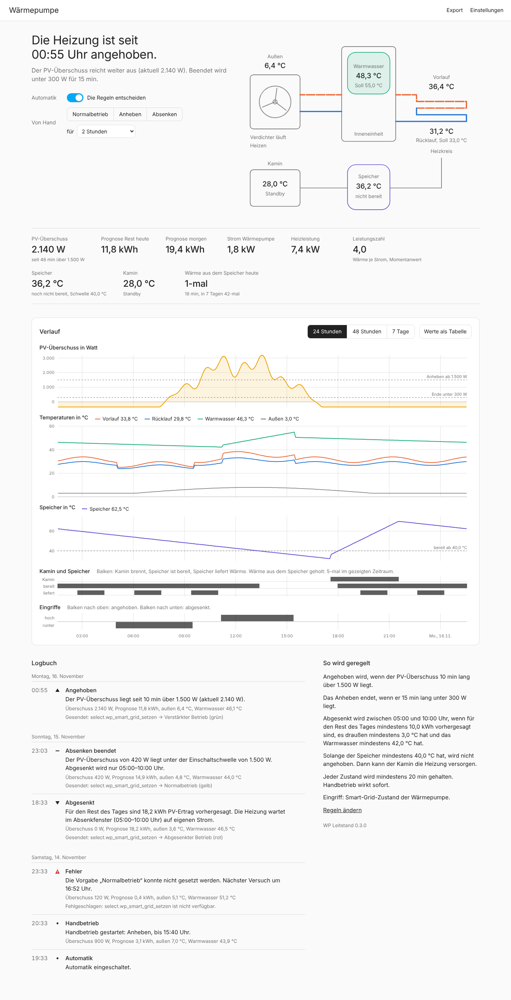

# WP Leitstand

Eine Integration für Home Assistant, die eine Wärmepumpe in der Seitenleiste zeigt und die Heizung nach PV-Überschuss und PV-Prognose anhebt oder absenkt. Jede Schaltung steht mit Uhrzeit und Begründung im Logbuch.

Entstanden für eine Dimplex HPL 12S-TUW (Wärmepumpenmanager mit Software M) über Modbus RTU. Die Integration selbst ist herstellerneutral: Sie arbeitet mit beliebigen Entitäten, die du bei der Einrichtung auswählst.



Die Bilder zeigen erfundene Beispieldaten aus `dev/preview.html`. Dunkles Design: [docs/panel-dunkel.png](docs/panel-dunkel.png).

## Stand

Version 0.3.0. Die Regellogik und die Abläufe im Regler sind durch 36 automatische Tests abgedeckt, die beiden Exporte durch 15 weitere. Das Panel ist mit Beispieldaten in Chrome geprüft, einschließlich Erstellen und Herunterladen beider Exporte. **In einem laufenden Home Assistant und an einer echten Wärmepumpe ist die Integration noch nicht gelaufen.** Deshalb startet sie im Probebetrieb: Sie protokolliert, was sie tun würde, und sendet nichts.

## Was sie macht

- **Lage:** ein Satz, was die Heizung gerade tut und warum, daneben ein Anlagenschema mit Außen-, Vorlauf-, Rücklauf- und Warmwassertemperatur.
- **Kennwerte:** PV-Überschuss, Prognose für den Rest des Tages und für morgen, Stromaufnahme, Heizleistung, Leistungszahl.
- **Verlauf:** Überschuss, Temperaturen und Eingriffe auf einer gemeinsamen Zeitachse (24 Stunden, 48 Stunden, 7 Tage), mit Ablesung beim Überfahren und Tabellenansicht.
- **Regelung:** hebt an, wenn genug eigener Strom übrig ist, und senkt morgens ab, wenn die Prognose später Sonne verspricht.
- **Logbuch:** jede Schaltung mit Begründung, den Messwerten zum Zeitpunkt und dem Ergebnis (gesendet, nur protokolliert, fehlgeschlagen). Die Einträge erscheinen auch im Logbuch von Home Assistant.
- **Handbetrieb:** Normalbetrieb, Anheben oder Absenken für eine Dauer oder bis du ihn beendest.
- **Export:** zwei CSV-Dateien zum Auswerten, eine mit Verlauf und Entscheidungen, eine für die Effizienz.
- **Kamin und Speicher:** zeigt, wann der Kamin brennt, wann der Speicher bereit ist und wie oft Wärme aus ihm geholt wurde, und hebt nicht an, solange der Speicher die Heizung versorgen kann.

## Voraussetzungen

- Home Assistant 2025.1 oder neuer.
- Entitäten für die Wärmepumpe. Für Dimplex liegt ein fertiges Package bei: [`packages/dimplex_wpm.yaml`](packages/dimplex_wpm.yaml). Die Vorschläge bei der Einrichtung passen zu dessen Entitätsnamen.
- Ein Sensor für den PV-Überschuss (W oder kW). Geeignet ist auch ein Netzleistungs-Sensor, bei dem Einspeisung negativ ist; das Vorzeichen stellst du ein.
- Für das Absenken: ein Sensor „PV-Prognose Rest heute“ (kWh oder Wh), zum Beispiel aus Solcast oder Forecast.Solar.

## Installation

**Mit HACS:** HACS öffnen, Menü „Benutzerdefinierte Repositories“, die Adresse dieses Repositories mit Typ „Integration“ eintragen, „WP Leitstand“ installieren, Home Assistant neu starten.

**Von Hand:** den Ordner `custom_components/wp_leitstand` nach `/config/custom_components/` kopieren und Home Assistant neu starten.

Danach: Einstellungen, Geräte & Dienste, Integration hinzufügen, „WP Leitstand“. Die Einrichtung fragt in sechs Schritten nach Wärmepumpe, Photovoltaik, Kamin und Speicher, Regeln, Eingriff sowie Effizienz und Export. In der Seitenleiste erscheint anschließend „Wärmepumpe“.

## Wie geregelt wird

Die Regeln werden alle 30 Sekunden in dieser Reihenfolge geprüft:

1. **Handbetrieb** gilt sofort und vor allem anderen.
2. **Automatik aus:** Die Integration stellt einmal auf Normalbetrieb und fasst danach nichts mehr an.
3. **Kein Überschuss-Messwert:** Normalbetrieb, sofort. Ohne Daten wird nicht geregelt.
4. **Anheben:** wenn der Überschuss eine einstellbare Zeit über der Einschaltschwelle liegt (Standard 1.500 W für 10 min). Es endet, wenn er eine einstellbare Zeit unter der Ausschaltschwelle liegt (300 W für 15 min).
5. **Absenken:** im Absenkfenster (05:00 bis 10:00 Uhr), wenn die Prognose für den Rest des Tages reicht (10 kWh), es draußen nicht zu kalt ist (3 °C) und das Warmwasser warm genug ist (42 °C). Die beiden Temperaturgrenzen lassen sich abschalten, indem man das Feld leert.
6. Sonst **Normalbetrieb**.

Wechsel aus den Regeln 4 bis 6 warten eine Mindesthaltezeit ab (20 min), damit der Verdichter nicht taktet.

Alle Werte lassen sich unter Einstellungen, Geräte & Dienste, WP Leitstand, „Konfigurieren“ ändern.

### Eingriff an der Wärmepumpe

| Stellgröße | Was passiert |
|---|---|
| Probebetrieb (Standard) | Nichts wird gesendet. Entscheidungen stehen als „nur protokolliert“ im Logbuch. |
| Smart Grid | Eine Auswahl-Entität wird auf die Option für Normal, Anheben oder Absenken gestellt. Bei Dimplex hebt „grün“ Heizung und Warmwasser an, „rot“ senkt beide ab; die Beträge stellt man am Wärmepumpenmanager ein. |
| Parallelverschiebung | Eine Zahl-Entität wird um einen Betrag erhöht oder verringert. Der Wert vor dem Eingriff wird gemerkt und danach wiederhergestellt. |

Geht eine Vorgabe an der Wärmepumpe verloren (bei Dimplex etwa nach einem Spannungsreset), setzt die Integration sie nach fünf Minuten erneut und schreibt das ins Logbuch. Schlägt ein Schreiben fehl, steht der Grund im Logbuch und im Panel; der nächste Versuch folgt nach fünf Minuten.

Im Normalbetrieb stellt die Smart-Grid-Variante standardmäßig „Normalbetrieb (gelb)“ ein. Wer stattdessen die Hardware-Eingänge der Wärmepumpe gelten lassen will, trägt als Option für Normalbetrieb „Hardware-Eingang“ ein.

## Kamin und Speicher

Für Anlagen mit wasserführendem Kamin und einem Speicher, aus dem sich die Heizung bedient (bei Dimplex die Betriebsart „Bivalent-Regenerativ“). Alles im Schritt „Kamin und Speicher“ ist freiwillig.

| Einstellung | Wofür | Beispiel |
|---|---|---|
| Temperatur im Speicher | Anzeige, „bereit“, Regel | `sensor.wp_regenerativspeicher_temperatur` (Fühler R13, Modbus-Register 10) |
| Speicher gilt als bereit ab | Schwelle für „bereit“ | 40 °C |
| Sperre der Wärmepumpe | erkennt, wann der Speicher liefert | `sensor.wp_sperre` mit dem Wert „Regenerativ“ |
| Temperatur am Kamin | Anzeige, „brennt“ | Abgastemperatur einer Spartherm S-Thermatik NEO über [esphome-thermatik](https://github.com/vk496/esphome-thermatik) |
| Kamin gilt als an ab | Schwelle für „brennt“ | 80 °C |
| Status des Kamins | Text im Schema | Sensor „Status“ aus demselben Package |

Im Panel erscheint dann:

- im Anlagenschema eine zweite Reihe mit Kamin und Speicher; die Leitungen färben sich, wenn der Kamin brennt und wenn der Speicher liefert
- bei den Kennwerten Speicher- und Kamintemperatur sowie „Wärme aus dem Speicher heute“ mit Anzahl, Dauer und der Anzahl der letzten sieben Tage
- im Verlauf die Speichertemperatur mit der Bereit-Schwelle und drei Balkenzeilen: Kamin brennt, Speicher bereit, Speicher liefert

„Wärme aus dem Speicher geholt“ heißt: Die Wärmepumpe meldet die Sperre „Regenerativ“. Gezählt wird jeder zusammenhängende Abschnitt.

**Regel:** Solange der Speicher bereit ist, wird nicht angehoben, und ein laufendes Anheben endet nach der Mindesthaltezeit. Hintergrund: Im Smart-Grid-Zustand Grün entlädt eine Dimplex den regenerativen Speicher nicht und gibt der Wärmepumpe Vorrang. Die Regel lässt sich abschalten.

## Export

Oben im Panel öffnet „Export“ einen Dialog mit Inhalt und Zeitraum (24 Stunden, 7 Tage, 30 Tage). Die Datei wird im Browser aus dem Verlauf von Home Assistant berechnet und dann heruntergeladen; wo der Browser es unterstützt, erscheint zusätzlich „Teilen“.


Beide Dateien sind UTF-8 mit Komma als Trenner und Dezimalpunkt. Am Anfang stehen Zeilen mit `#`: Version, Zeitraum, Erklärung der Spalten, alle Regeln und welcher Sensor hinter welcher Spalte steckt. Nicht hinterlegte Sensoren ergeben leere Spalten, das Spaltenschema bleibt gleich.

**Verlauf und Entscheidungen** – eine Zeile je Zeitraster (1, 5 oder 15 Minuten):

- PV-Überschuss, Prognosen, Außen-, Vorlauf-, Rücklauf- und Warmwassertemperatur mit Sollwerten, Strom und Heizleistung als zeitgewichtete Mittelwerte
- Verdichter: Laufanteil und Einschaltvorgänge im Raster
- Betriebsstatus, Regelzustand und Smart-Grid-Auswahl am Ende des Rasters
- Zählerstände, Heizstab, zweiter Wärmeerzeuger, Speicher- und Kamintemperatur, Sperre und die frei gewählten weiteren Sensoren
- `ereignisse`: die Logbuch-Einträge, die in das Raster fallen, mit Uhrzeit, Ergebnis und Begründung

**Effizienz** – drei Tabellen in einer Datei, jede beginnt mit `# tabelle: name`:

- `stundenwerte`: Außentemperatur, Vorlauf und Rücklauf nur während der Verdichter läuft, Vorlauf-Maximum, Warmwasser, Laufminuten und Starts, Minuten je Betriebsstatus (zum Beispiel Abtauen), Minuten mit Heizstab und zweitem Wärmeerzeuger, Strom und Wärme aus den Leistungs-Sensoren aufsummiert, Zunahme der Zähler, PV-Überschuss und Netzbezug als Energie, Minuten angehoben und abgesenkt
- `verdichterlaeufe`: eine Zeile je Lauf mit Beginn, Ende, Dauer, Pause davor, Betriebsart, Regelzustand, mittleren Temperaturen, Warmwasser am Anfang und Ende, Strom und Wärme des Laufs
- `speicherentnahmen`: eine Zeile je Abschnitt, in dem der Speicher statt der Wärmepumpe geliefert hat, mit Dauer und Speichertemperatur am Anfang und Ende

Die Stundenwerte enthalten dazu Speicher- und Kamintemperatur, Minuten mit brennendem Kamin, mit bereitem Speicher und mit Sperre „Regenerativ“. So lässt sich Kamin-Wärme von der Arbeit der Wärmepumpe trennen; in deren Wärmemengen steckt sie nicht.

Daraus lassen sich Arbeitszahl je Tag, je Betriebsart und je Lauf, Taktung, Abtauanteil, Heizstab-Einsatz und der Einfluss des Anhebens berechnen. Je mehr unter „Effizienz und Export“ hinterlegt ist (Stromzähler, Wärmemengen, Heizstab), desto belastbarer wird die Auswertung. Ohne Zähler wird aus den Leistungs-Sensoren aufsummiert.

Zu beachten:

- Home Assistant bewahrt den genauen Verlauf standardmäßig zehn Tage auf. Ältere Zeiträume bleiben leer und werden am Rand abgeschnitten.
- Der Export für 30 Tage lädt viele Daten und kann auf dem Handy eine Weile dauern.
- Das Herunterladen ist in Chrome geprüft. Ob es in der Home-Assistant-App funktioniert, ist nicht getestet; notfalls Home Assistant im Browser öffnen.

## Entitäten und Dienste

- `sensor.wp_leitstand_regelzustand`: `normal`, `boost` oder `setback`, mit Begründung (`reason`), Zeitpunkt (`since`) und Handbetrieb als Attributen.
- `switch.wp_leitstand_automatik`: Automatik ein oder aus.
- `wp_leitstand.set_override` (`mode`, optional `minutes`) und `wp_leitstand.clear_override`: Handbetrieb aus Automationen heraus.

Die Entitäts-IDs richten sich nach der Sprache von Home Assistant bei der Einrichtung.

## Grenzen

- Die Texte im Panel und im Logbuch sind deutsch. Die Einrichtungsdialoge gibt es deutsch und englisch.
- Eine Installation je Home Assistant.
- Die Integration liest und schreibt über Entitäten. Sie spricht nicht selbst Modbus.
- Die Prognose für morgen wird angezeigt, aber noch nicht für Regeln benutzt.
- Im Repository liegt noch keine Lizenzdatei.

## Entwicklung

```bash
pytest tests                       # Regellogik und Abläufe im Regler, ohne Home Assistant
node --test tests/test_export.mjs  # Rechenfunktionen der beiden Exporte
python3 -m http.server 8000        # dann http://localhost:8000/dev/preview.html
python3 dev/screenshot.py /tmp/shots   # Panel rendern und beide Exporte erzeugen (braucht Playwright und Chrome)
python3 dev/build_translations.py  # translations/de.json und en.json neu erzeugen
```

Aufbau:

| Datei | Aufgabe |
|---|---|
| `logic.py` | Entscheidung aus Messwerten und Einstellungen, ohne Home-Assistant-Importe |
| `controller.py` | Messwerte lesen, entscheiden lassen, stellen, nachführen, Logbuch führen |
| `config_flow.py` | Einrichtung und Einstellungen |
| `websocket_api.py` | Schnittstelle zwischen Panel und Regler |
| `frontend/wp-leitstand-panel.js` | Panel und Exporte, ohne Build-Schritt und ohne externe Abhängigkeiten |

Vor der Veröffentlichung in `manifest.json` den Platzhalter `OWNER` in den beiden Adressen durch den GitHub-Namen ersetzen.
