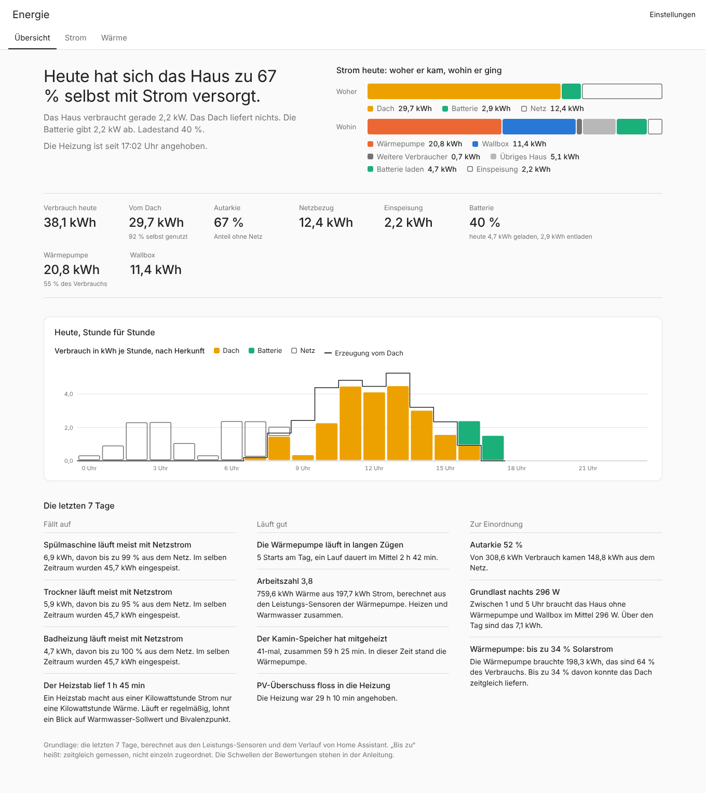
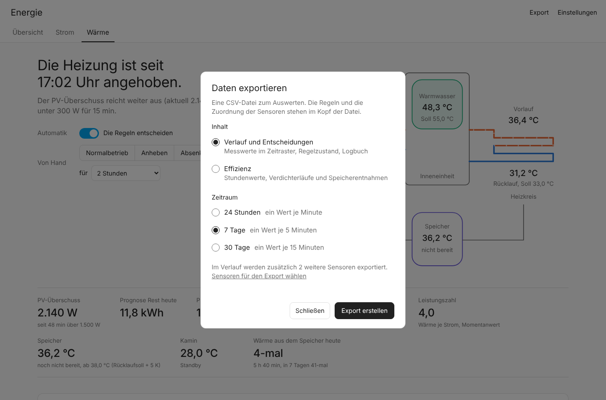

# Energy Hub

[](https://my.home-assistant.io/redirect/hacs_repository/?owner=hubelbubel&repository=ha-energy-hub&category=integration)
[](https://my.home-assistant.io/redirect/config_flow_start/?domain=energy_hub)

Eine Integration für Home Assistant, die Strom und Wärme eines Hauses in der Seitenleiste zusammenführt: woher der Strom kommt und wohin er geht, was die Wärmepumpe tut, und was in der letzten Woche gut lief und was auffiel. Die Heizung wird nach PV-Überschuss und PV-Prognose angehoben oder abgesenkt; jede Schaltung steht mit Uhrzeit und Begründung im Logbuch.

Entstanden für ein Haus mit Dimplex-Wärmepumpe (Modbus RTU), wasserführendem Kamin, PV mit ZCS-Azzurro-Wechselrichter und Tigo-Optimierern, Batterie und Wallbox. Die Integration selbst ist herstellerneutral: Sie arbeitet mit beliebigen Entitäten, die du bei der Einrichtung auswählst.



Die Bilder zeigen erfundene Beispieldaten aus `dev/preview.html`. Weitere: [Strom](docs/strom.png), [PV](docs/pv.png), [Wärme hell](docs/panel-hell.png), [Wärme dunkel](docs/panel-dunkel.png).

## Die vier Bereiche

**Übersicht**

- der Tag in einem Satz: wie weit sich das Haus heute selbst mit Strom versorgt hat, was es gerade verbraucht, was die Heizung tut
- Strombilanz von heute als zwei Balken auf gleicher Skala: woher der Strom kam (Dach, Batterie, Netz) und wohin er ging (Wärmepumpe, Wallbox, weitere Verbraucher, übriges Haus, Batterie, Einspeisung)
- „Heute, Stunde für Stunde“: Verbrauch je Stunde nach Herkunft, dazu die Erzeugung vom Dach als Linie
- Auswertung der letzten sieben Tage in drei Spalten: fällt auf, läuft gut, zur Einordnung

**Strom** – nur Anzeige, hier wird nichts geregelt. Batterie und Wallbox steuern sich weiter selbst.

- Bilanz jetzt und Kennwerte von heute: Verbrauch, Erzeugung, Eigenverbrauch, Autarkie, Netzbezug, Einspeisung, Batterie, Wärmepumpe, Wallbox
- Verlauf über 24 Stunden, 48 Stunden oder 7 Tage: Erzeugung und Verbrauch, Netz, Batterie, Ladestand, Verbraucher
- Rangliste der Verbraucher von heute

**PV** – Wechselrichter und Tigo-Optimierer zusammen, nur Anzeige.

- was das Dach gerade liefert, wie viel heute erzeugt wurde, ob sich alle Optimierer melden und welches Paneel gerade zurückfällt
- „Paneele jetzt“: eine Kachel je Optimierer mit aktueller Leistung; ein Klick hebt das Paneel im Verlauf hervor
- Kennwerte: Erzeugung heute (Wechselrichter, darunter die Optimierer), Spitze, Eigenverbrauch, Hausverbrauch, Spannung und Strom je MPPT, Status des Wechselrichters, Optimierer
- Verlauf über 24 Stunden, 48 Stunden oder 7 Tage, umschaltbar:
  - Anlage: Leistung am Wechselrichter gegen die Summe der Optimierer, Spannung am MPPT gegen die Summe der Ausgangsspannungen, Strom je MPPT
  - Paneele: Leistung, Spannung, Strom oder Temperatur aller Paneele; die übrigen grau, bis zu sieben farbig hervorgehoben, dazu der Median
- Wechselrichter und Optimierer im Vergleich, je String: jetzt und heute
- Paneele heute: Ertrag je Paneel und Anteil am Median im String
- Auswertung der letzten 7 Tage und Export

**Wärme** – Lage der Heizung mit Anlagenschema, Verlauf, Logbuch, Regeln, Handbetrieb und Export. Alles Weitere dazu steht unten.

## Strom: was hinterlegt wird und wie gerechnet wird

Im Schritt „Strom“ wählst du Leistungs-Sensoren (W oder kW). Energie in kWh braucht die Integration nicht; sie summiert die Leistung aus der Statistik von Home Assistant in 5-Minuten-Schritten auf.

| Einstellung | Hinweis |
|---|---|
| Leistung am Netzanschluss | ein Sensor mit Vorzeichen; welche Richtung positiv ist, stellst du ein |
| Leistung der PV-Anlage | |
| Leistung der Batterie | ein Sensor mit Vorzeichen, zum Beispiel aus der Integration deiner Batterie |
| Ladestand der Batterie | in Prozent |
| Verbrauch des Hauses | freiwillig; ohne ihn gilt Verbrauch = PV + Bezug − Einspeisung + Entladen − Laden |
| Leistung der Wallbox | zum Beispiel aus der go-e-Integration |
| Weitere Verbraucher | beliebig viele Leistungs-Sensoren, etwa Badheizung, Waschmaschine, Trockner, Spülmaschine |

Die Wärmepumpe kommt aus dem Schritt „Wärmepumpe“ (elektrische Leistung).

- **Eigenverbrauch** ist der Anteil des Solarstroms, der nicht eingespeist wurde. Laden der Batterie zählt dazu.
- **Autarkie** ist der Anteil des Verbrauchs, der nicht aus dem Netz kam.
- **Übriges Haus** ist der Verbrauch abzüglich Wärmepumpe, Wallbox und der hinterlegten Verbraucher.
- Die Werte von heute hinken bis zu zehn Minuten nach, weil Home Assistant die Statistik in 5-Minuten-Blöcken schreibt.
- Sensoren ohne Statistik (ohne `state_class: measurement`) werden aus dem Verlauf gelesen; das ist langsamer.

## PV: Wechselrichter und Optimierer

Im Schritt „Wechselrichter“ wählst du die Sensoren deines Wechselrichters. Alles ist freiwillig; was fehlt, wird im Bereich PV weggelassen.

| Einstellung | Hinweis |
|---|---|
| Status des Wechselrichters | Text oder Code. Die Codes 0 bis 7 von ZCS Azzurro und Sofar (Register 1028) werden übersetzt: 0 wartet, 1 prüft, 2 am Netz, 3 Notstrom, 4 behebbarer Fehler, 5 dauerhafter Fehler, 6 Update, 7 Selbstladung |
| MPPT 1 und 2: Leistung, Spannung, Strom | Leistung leer lassen, dann wird sie aus Spannung mal Strom berechnet |
| Erzeugung, Hausverbrauch, Netzbezug, Einspeisung | Zähler des Wechselrichters in kWh, je „heute“ und „gesamt“ |
| Netzfrequenz | Anzeige und Export |
| Tigo-String an MPPT 1 und 2 | Name des Strings wie in tigo_rs485, zum Beispiel `A`. Leer: Ein einziger String gehört zu MPPT 1, zwei Strings bei zwei MPPTs in ihrer Reihenfolge |

Die Vorschläge passen zu einer Modbus-Konfiguration für ZCS Azzurro HYD mit Entitäten wie `sensor.pv_power` (Register 1414, Leistung an PV1), `sensor.azzurro_pv1_spannung` und `sensor.pv_generation_today`. Wer Energy Hub schon eingerichtet hatte, bekommt sie beim ersten Öffnen des Schritts eingetragen, soweit es die Entitäten gibt.

Die **Gesamtleistung** kommt aus „Leistung der PV-Anlage“ im Schritt Strom, sonst aus der Summe der MPPTs.

Die **Optimierer** findet das Panel selbst, wenn die Integration [tigo_rs485](https://github.com/Zwer2k/ha-tigo-rs485) eingerichtet ist. Gelesen wird das Entitätsregister, nicht die Namen der Entitäten: Umbenennen stört also nicht. Es zählen nur Optimierer mit Label; der String kommt aus deren Einstellungen (sonst aus dem Label, A1 gehört zu A). Die Werte stammen aus der Statistik von Home Assistant, für 24 und 48 Stunden in 5-Minuten-Schritten, für 7 Tage als Stundenwerte.

Was verglichen wird:

- **Leistung:** Die Optimierer messen am Modul, der Wechselrichter am Eingang des MPPT. Ein paar Prozent Unterschied sind Verluste in Optimierern und Kabeln und die Messgenauigkeit.
- **Spannung:** Die Ausgangsspannungen der Optimierer eines Strings addieren sich und sollten nahe an der Spannung des MPPT liegen.
- **Paneele untereinander:** jedes Paneel gegen den Median der Paneele im selben String. Der Median ist robust gegen einzelne Ausreißer.

### Auswertung der PV

Die Aussagen erscheinen im Bereich PV und in der Übersicht. Grundlage sind Stundenwerte der letzten sieben Kalendertage. Ein Tag zählt nur, wenn das mittlere Paneel mindestens 0,15 kWh geliefert hat.

| Aussage | Bedingung |
|---|---|
| Der Wechselrichter meldete einen Fehler | Status 4 oder 5 (oder ein Text mit „Fehler“, „Fault“, „Störung“) |
| PV-Ertrag in 7 Tagen | Summe am Wechselrichter, sonst der Optimierer; ohne Bewertung |
| Optimierer und Wechselrichter stimmen überein | höchstens 6 % Unterschied über die Woche, je String |
| Am Wechselrichter kommt weniger an | über 12 % weniger als die Optimierer messen |
| Der Wechselrichter misst mehr als die Optimierer | über 6 % mehr, etwa wenn Module ohne Optimierer im String hängen |
| Paneel liefert dauerhaft weniger | unter 90 % des Medians an mindestens 60 % der Tage, bei mindestens 3 Tagen; höchstens drei |
| Paneel fällt zu einer Tageszeit ab | aufeinanderfolgende Stunden unter 80 % des Medians, sonst mindestens 90 %; gezählt werden Stunden mit mindestens 15 % der stärksten Stunde |
| Optimierer meldet sich zeitweise nicht | in mindestens 2 Stunden fiel er auf 0 W, während der Median der anderen mindestens 20 W betrug |
| Optimierer wurde heiß | ab 75 °C |
| Alle Paneele liefern gleichmäßig | jedes Paneel mindestens 95 % des Medians |

Die Schwellen sind Setzungen dieses Projekts und stehen in `PV_LIMITS` im Panel.

## Auswertung der letzten sieben Tage

Die Aussagen in der Übersicht sind feste Regeln mit Zahlen, kein Sprachmodell. Jede erscheint nur, wenn die nötigen Sensoren hinterlegt sind. Die Schwellen sind Setzungen dieses Projekts.

| Aussage | Bedingung |
|---|---|
| Das Haus versorgt sich überwiegend selbst | Autarkie mindestens 60 %; darunter steht der Wert unter „zur Einordnung“ |
| Fast aller Solarstrom bleibt im Haus / Viel Solarstrom geht ins Netz | Eigenverbrauch mindestens 80 % / unter 50 %, bei mindestens 1 kWh Erzeugung |
| Eingespeist, obwohl die Batterie nicht voll war | mindestens 1 kWh und 20 % der Einspeisung bei Ladestand unter 95 % |
| Netzbezug, obwohl die Batterie geladen war | mindestens 1 kWh und 20 % des Bezugs bei Ladestand über 20 % |
| Grundlast nachts | Median des Verbrauchs zwischen 1 und 5 Uhr ohne Wärmepumpe und Wallbox; ohne Bewertung |
| Wärmepumpe: Anteil Solarstrom | Anteil, den das Dach zeitgleich liefern konnte; „überwiegend bei Sonne“ ab 50 % |
| … läuft meist mit Netzstrom | Verbraucher mit mindestens 1 kWh, davon mindestens 60 % zeitgleich mit Netzbezug, während mindestens halb so viel eingespeist wurde; höchstens drei |
| Die Wärmepumpe taktet / läuft in langen Zügen | mittlere Laufzeit unter 10 min / mindestens 30 min, bei mindestens fünf vollständigen Läufen |
| Arbeitszahl | Wärme durch Strom aus den Leistungs-Sensoren; gut ab 3,5, auffällig unter 2,5 |
| Der Heizstab lief | jede Laufzeit über null |
| Der Kamin-Speicher hat mitgeheizt | mindestens eine Entnahme |
| PV-Überschuss floss in die Heizung | Zeit im Zustand „angehoben“ über null, mit gewähltem Eingriff |
| Im Probebetrieb hätte die Regelung angehoben | dasselbe im Probebetrieb; ohne Bewertung, gesendet wurde nichts |
| Die Regelung läuft im Probebetrieb | solange kein Eingriff gewählt ist |

Die Aussagen zur Wärme erscheinen nur, wenn mindestens ein Sensor der Wärmepumpe hinterlegt ist.

„Bis zu“ in einer Aussage heißt: zeitgleich gemessen, nicht einzeln zugeordnet. Läuft die Spülmaschine, während das Haus Strom aus dem Netz bezieht, zählt ihr Verbrauch bis zur Höhe des Bezugs als Netzstrom.

## Stand

Version 0.5.1. Die Regellogik und die Abläufe im Regler sind durch 39 automatische Tests abgedeckt, die Erkennung der Tigo-Optimierer durch 5, die Exporte durch 15, die Rechnungen für Strom und Auswertung durch 9 und die für PV durch 8 weitere. Der Bereich PV ist mit Beispieldaten geprüft (16 Optimierer an einem MPPT), noch nicht an der echten Anlage. Mit Beispieldaten geprüft ist auch, wie das Panel ohne Wärmepumpe, mit nicht erreichbarer Wärmepumpe, nur mit PV und nur mit Strom aussieht. Das Panel ist mit Beispieldaten in Chrome geprüft, einschließlich Erstellen und Herunterladen beider Exporte. **In einem laufenden Home Assistant und an einer echten Wärmepumpe ist die Integration noch nicht gelaufen.** Deshalb startet sie im Probebetrieb: Sie protokolliert, was sie tun würde, und sendet nichts.

## Wärme: was der Bereich macht

- **Lage:** ein Satz, was die Heizung gerade tut und warum, daneben ein Anlagenschema mit Außen-, Vorlauf-, Rücklauf- und Warmwassertemperatur.
- **Kennwerte:** PV-Überschuss, Prognose für den Rest des Tages und für morgen, Stromaufnahme, Heizleistung, Leistungszahl.
- **Verlauf:** Überschuss, Temperaturen und Eingriffe auf einer gemeinsamen Zeitachse (24 Stunden, 48 Stunden, 7 Tage), mit Ablesung beim Überfahren und Tabellenansicht.
- **Regelung:** hebt an, wenn genug eigener Strom übrig ist, und senkt morgens ab, wenn die Prognose später Sonne verspricht.
- **Logbuch:** jede Schaltung mit Begründung, den Messwerten zum Zeitpunkt und dem Ergebnis (gesendet, nur protokolliert, fehlgeschlagen). Die Einträge erscheinen auch im Logbuch von Home Assistant.
- **Handbetrieb:** Normalbetrieb, Anheben oder Absenken für eine Dauer oder bis du ihn beendest.
- **Export:** zwei CSV-Dateien zum Auswerten, eine mit Verlauf und Entscheidungen, eine für die Effizienz.
- **Kamin und Speicher:** zeigt, wann der Kamin brennt, wann der Speicher bereit ist und wie oft Wärme aus ihm geholt wurde, und hebt nicht an, solange der Speicher die Heizung versorgen kann.

## Voraussetzungen

- Home Assistant 2025.1 oder neuer.
- Für die Bereiche, die du nutzen willst, die passenden Sensoren (siehe „Was gebraucht wird“). Keiner davon ist Pflicht.
- Für die Regelung: Entitäten für die Wärmepumpe. Für Dimplex liegt ein fertiges Package bei: [`packages/dimplex_wpm.yaml`](packages/dimplex_wpm.yaml). Die Vorschläge bei der Einrichtung passen zu dessen Entitätsnamen.
- Ein Sensor für den PV-Überschuss (W oder kW). Geeignet ist auch ein Netzleistungs-Sensor, bei dem Einspeisung negativ ist; das Vorzeichen stellst du ein.
- Für das Absenken: ein Sensor „PV-Prognose Rest heute“ (kWh oder Wh), zum Beispiel aus Solcast oder Forecast.Solar.

## Was gebraucht wird

Energy Hub braucht nicht alle Teile. Was fehlt, lässt das Panel weg oder sagt, was zu hinterlegen wäre. Bei der Einrichtung werden nur Entitäten vorgeschlagen, die es in deinem Home Assistant gibt.

| Bereich | Mindestens | Fehlt etwas |
|---|---|---|
| Übersicht | Netzanschluss oder Leistung der PV-Anlage (Schritt Strom) | Ohne Wärmepumpe wird die Heizung nicht erwähnt, die Aussagen zur Wärme entfallen |
| Strom | Netzanschluss und Leistung der PV-Anlage | Batterie, Wallbox und Verbraucher erscheinen nur, wenn sie hinterlegt sind |
| PV | Leistung der PV-Anlage, Sensoren des Wechselrichters oder die Integration tigo_rs485 | Ohne Wechselrichter kein Abgleich mit den Optimierern, ohne Optimierer keine Paneele |
| Wärme | ein Sensor der Wärmepumpe | Ohne Wärmepumpe kein Anlagenschema. Mit Sensor für den PV-Überschuss läuft die Regelung trotzdem mit und schreibt ins Logbuch, wann sie angehoben oder abgesenkt hätte |
| Regelung | Sensor für den PV-Überschuss, für das Absenken die Prognose | Ohne Überschuss bleibt die Heizung im Normalbetrieb |

Ist die Wärmepumpe hinterlegt, meldet aber keiner ihrer Sensoren einen Wert (etwa weil die Modbus-Karte fehlt), zeigt der Bereich Wärme einen Hinweis statt leerer Werte. Ist ein Eingriff gewählt, stehen die fehlgeschlagenen Versuche als Fehler im Logbuch.

## Installation

**Mit dem Marketplace** (ab Home Assistant 2026.11, vorher HACS): Der erste Knopf oben öffnet dieses Repository direkt in deinem Home Assistant; dort „Energy Hub“ herunterladen und Home Assistant neu starten. Ohne Knopf: Einstellungen, Marketplace (oder HACS), Menü „Benutzerdefinierte Repositories“, die Adresse dieses Repositories mit Typ „Integration“ eintragen. Updates erscheinen danach wie bei anderen Integrationen.

**Von Hand:** den Ordner `custom_components/energy_hub` nach `/config/custom_components/` kopieren und Home Assistant neu starten.

Danach: Einstellungen, Geräte & Dienste, Integration hinzufügen, „Energy Hub“, oder der zweite Knopf oben. Die Einrichtung fragt in acht Schritten nach Wärmepumpe, Strom, Photovoltaik, Wechselrichter, Kamin und Speicher, Regeln, Eingriff sowie Effizienz und Export. Jeder Schritt kann leer bleiben und später unter „Konfigurieren“ nachgeholt werden. In der Seitenleiste erscheint anschließend „Energie“.

## Wie geregelt wird

Die Regeln werden alle 30 Sekunden in dieser Reihenfolge geprüft:

1. **Handbetrieb** gilt sofort und vor allem anderen.
2. **Automatik aus:** Die Integration stellt einmal auf Normalbetrieb und fasst danach nichts mehr an.
3. **Kein Überschuss-Messwert:** Normalbetrieb, sofort. Ohne Daten wird nicht geregelt.
4. **Anheben:** wenn der Überschuss eine einstellbare Zeit über der Einschaltschwelle liegt (Standard 1.500 W für 10 min). Es endet, wenn er eine einstellbare Zeit unter der Ausschaltschwelle liegt (300 W für 15 min).
5. **Absenken:** im Absenkfenster (05:00 bis 10:00 Uhr), wenn die Prognose für den Rest des Tages reicht (10 kWh), es draußen nicht zu kalt ist (3 °C) und das Warmwasser warm genug ist (42 °C). Die beiden Temperaturgrenzen lassen sich abschalten, indem man das Feld leert.
6. Sonst **Normalbetrieb**.

Wechsel aus den Regeln 4 bis 6 warten eine Mindesthaltezeit ab (20 min), damit der Verdichter nicht taktet.

Alle Werte lassen sich unter Einstellungen, Geräte & Dienste, Energy Hub, „Konfigurieren“ ändern.

### Eingriff an der Wärmepumpe

| Stellgröße | Was passiert |
|---|---|
| Probebetrieb (Standard) | Nichts wird gesendet. Entscheidungen stehen als „nur protokolliert“ im Logbuch. |
| Smart Grid | Eine Auswahl-Entität wird auf die Option für Normal, Anheben oder Absenken gestellt. Bei Dimplex hebt „grün“ Heizung und Warmwasser an, „rot“ senkt beide ab; die Beträge stellt man am Wärmepumpenmanager ein. |
| Parallelverschiebung | Eine Zahl-Entität wird um einen Betrag erhöht oder verringert. Der Wert vor dem Eingriff wird gemerkt und danach wiederhergestellt. |

Geht eine Vorgabe an der Wärmepumpe verloren (bei Dimplex etwa nach einem Spannungsreset), setzt die Integration sie nach fünf Minuten erneut und schreibt das ins Logbuch. Schlägt ein Schreiben fehl, steht der Grund im Logbuch und im Panel; der nächste Versuch folgt nach fünf Minuten.

Im Normalbetrieb stellt die Smart-Grid-Variante standardmäßig „Normalbetrieb (gelb)“ ein. Wer stattdessen die Hardware-Eingänge der Wärmepumpe gelten lassen will, trägt als Option für Normalbetrieb „Hardware-Eingang“ ein.

## Kamin und Speicher

Für Anlagen mit wasserführendem Kamin und einem Speicher, aus dem sich die Heizung bedient (bei Dimplex die Betriebsart „Bivalent-Regenerativ“). Alles im Schritt „Kamin und Speicher“ ist freiwillig.

| Einstellung | Wofür | Beispiel |
|---|---|---|
| Temperatur im Speicher | Anzeige, „bereit“, Regel | `sensor.wp_regenerativspeicher_temperatur` (Fühler R13, Modbus-Register 10) |
| Bereit ab Rücklauf-Solltemperatur plus | Differenz für „bereit“ | 5 K |
| Ersatz-Schwelle | gilt nur ohne Rücklauf-Solltemperatur | 40 °C |
| Sperre der Wärmepumpe | erkennt, wann der Speicher liefert | `sensor.wp_sperre` mit dem Wert „Regenerativ“ |
| Temperatur am Kamin | Anzeige, „brennt“ | Abgastemperatur einer Spartherm S-Thermatik NEO über [esphome-thermatik](https://github.com/vk496/esphome-thermatik) |
| Kamin gilt als an ab | Schwelle für „brennt“ | 80 °C |
| Status des Kamins | Text im Schema | Sensor „Status“ aus demselben Package |

Im Panel erscheint dann:

- im Anlagenschema eine zweite Reihe mit Kamin und Speicher; die Leitungen färben sich, wenn der Kamin brennt und wenn der Speicher liefert
- bei den Kennwerten Speicher- und Kamintemperatur sowie „Wärme aus dem Speicher heute“ mit Anzahl, Dauer und der Anzahl der letzten sieben Tage
- im Verlauf die Speichertemperatur mit der mitlaufenden Bereit-Schwelle (gestrichelt) und drei Balkenzeilen: Kamin brennt, Speicher bereit, Speicher liefert

„Bereit“ wird so berechnet wie im Regler der Wärmepumpe: Der Speicher muss um die eingestellte Differenz wärmer sein als die aktuelle Rücklauf-Solltemperatur. Bei mildem Wetter reicht also ein kühlerer Speicher als bei Frost. Trage als Differenz denselben Wert ein, der am Wärmepumpenmanager als Übertemperatur für den regenerativen Speicher eingestellt ist (bei Dimplex 2 bis 20 K). Der Regler vergleicht außerdem mit der jeweils anstehenden Anforderung, bei Warmwasser also mit dessen Sollwert; die Integration rechnet nur mit dem Rücklaufsoll der Heizung.

„Wärme aus dem Speicher geholt“ heißt: Die Wärmepumpe meldet die Sperre „Regenerativ“. Gezählt wird jeder zusammenhängende Abschnitt.

**Regel:** Solange der Speicher bereit ist, wird nicht angehoben, und ein laufendes Anheben endet nach der Mindesthaltezeit. Hintergrund: Im Smart-Grid-Zustand Grün entlädt eine Dimplex den regenerativen Speicher nicht und gibt der Wärmepumpe Vorrang. Die Regel lässt sich abschalten.

## Export

Im Bereich Wärme öffnet „Export“ oben einen Dialog mit Inhalt und Zeitraum (24 Stunden, 7 Tage, 30 Tage). Im Bereich PV öffnet derselbe Knopf den PV-Export (siehe unten). Die Datei wird im Browser aus dem Verlauf von Home Assistant berechnet und dann heruntergeladen; wo der Browser es unterstützt, erscheint zusätzlich „Teilen“.



Alle Dateien sind UTF-8 mit Komma als Trenner und Dezimalpunkt. Am Anfang stehen Zeilen mit `#`: Version, Zeitraum, Erklärung der Spalten, alle Regeln und welcher Sensor hinter welcher Spalte steckt. Nicht hinterlegte Sensoren ergeben leere Spalten, das Spaltenschema bleibt gleich.

**Verlauf und Entscheidungen** – eine Zeile je Zeitraster (1, 5 oder 15 Minuten):

- PV-Überschuss, Prognosen, Außen-, Vorlauf-, Rücklauf- und Warmwassertemperatur mit Sollwerten, Strom und Heizleistung als zeitgewichtete Mittelwerte
- Verdichter: Laufanteil und Einschaltvorgänge im Raster
- Betriebsstatus, Regelzustand und Smart-Grid-Auswahl am Ende des Rasters
- Zählerstände, Heizstab, zweiter Wärmeerzeuger, Speicher- und Kamintemperatur, Sperre und die frei gewählten weiteren Sensoren
- `ereignisse`: die Logbuch-Einträge, die in das Raster fallen, mit Uhrzeit, Ergebnis und Begründung

**Effizienz** – drei Tabellen in einer Datei, jede beginnt mit `# tabelle: name`:

- `stundenwerte`: Außentemperatur, Vorlauf und Rücklauf nur während der Verdichter läuft, Vorlauf-Maximum, Warmwasser, Laufminuten und Starts, Minuten je Betriebsstatus (zum Beispiel Abtauen), Minuten mit Heizstab und zweitem Wärmeerzeuger, Strom und Wärme aus den Leistungs-Sensoren aufsummiert, Zunahme der Zähler, PV-Überschuss und Netzbezug als Energie, Minuten angehoben und abgesenkt
- `verdichterlaeufe`: eine Zeile je Lauf mit Beginn, Ende, Dauer, Pause davor, Betriebsart, Regelzustand, mittleren Temperaturen, Warmwasser am Anfang und Ende, Strom und Wärme des Laufs
- `speicherentnahmen`: eine Zeile je Abschnitt, in dem der Speicher statt der Wärmepumpe geliefert hat, mit Dauer und Speichertemperatur am Anfang und Ende

Die Stundenwerte enthalten dazu Speicher- und Kamintemperatur, Minuten mit brennendem Kamin, mit bereitem Speicher und mit Sperre „Regenerativ“. So lässt sich Kamin-Wärme von der Arbeit der Wärmepumpe trennen; in deren Wärmemengen steckt sie nicht.

Daraus lassen sich Arbeitszahl je Tag, je Betriebsart und je Lauf, Taktung, Abtauanteil, Heizstab-Einsatz und der Einfluss des Anhebens berechnen. Je mehr unter „Effizienz und Export“ hinterlegt ist (Stromzähler, Wärmemengen, Heizstab), desto belastbarer wird die Auswertung. Ohne Zähler wird aus den Leistungs-Sensoren aufsummiert.

**Photovoltaik** (im Bereich PV) – eine Datei mit vier Tabellen, Zeitraum 24 Stunden oder 7 Tage in 5-Minuten-Schritten, 30 Tage in Stunden. Die Werte kommen aus der Statistik von Home Assistant; nur der Status des Wechselrichters aus dem Verlauf.

- `anlage`: Leistung, Spannung und Strom je MPPT, Netzfrequenz, die Tageszähler des Wechselrichters, Status als Text und die Summe der Optimierer (bei mehreren Strings auch je String)
- `paneele`: eine Zeile je Zeitpunkt und Paneel mit Leistung, Eingangs- und Ausgangsspannung, Strom, Temperatur und PWM; Nachtzeilen ohne Leistung und Temperatur entfallen
- `tage_paneele`: Ertrag je Tag und Paneel, Anteil am Median im String, Spitze und höchste Temperatur
- `tage_anlage`: Erzeugung laut Wechselrichter (Zähler, sonst aus der Leistung), Summe der Optimierer, Abweichung, Hausverbrauch, Netzbezug, Einspeisung und Minuten im Fehlerzustand

Mit 16 Optimierern sind 7 Tage gut 1 MB groß. Die 5-Minuten-Werte bewahrt Home Assistant standardmäßig zehn Tage auf, Stundenwerte dauerhaft.

Zu beachten:

- Home Assistant bewahrt den genauen Verlauf standardmäßig zehn Tage auf. Ältere Zeiträume bleiben leer und werden am Rand abgeschnitten.
- Der Export für 30 Tage lädt viele Daten und kann auf dem Handy eine Weile dauern.
- Das Herunterladen ist in Chrome geprüft. Ob es in der Home-Assistant-App funktioniert, ist nicht getestet; notfalls Home Assistant im Browser öffnen.

## Entitäten und Dienste

- `sensor.energy_hub_regelzustand`: `normal`, `boost` oder `setback`, mit Begründung (`reason`), Zeitpunkt (`since`) und Handbetrieb als Attributen.
- `switch.energy_hub_automatik`: Automatik ein oder aus.
- `energy_hub.set_override` (`mode`, optional `minutes`) und `energy_hub.clear_override`: Handbetrieb aus Automationen heraus.

Die Entitäts-IDs richten sich nach der Sprache von Home Assistant bei der Einrichtung.

## Grenzen

- Die Texte im Panel und im Logbuch sind deutsch. Die Einrichtungsdialoge gibt es deutsch und englisch.
- Eine Installation je Home Assistant.
- Die Integration liest und schreibt über Entitäten. Sie spricht nicht selbst Modbus.
- Die Prognose für morgen wird angezeigt, aber noch nicht für Regeln benutzt.

## Entwicklung

```bash
pytest tests                       # Regellogik, Abläufe im Regler, Erkennung der Optimierer, ohne Home Assistant
node --test tests/test_export.mjs tests/test_energy.mjs tests/test_pv.mjs   # Rechenfunktionen für Exporte, Strom, PV und Auswertung
python3 -m http.server 8000        # dann http://localhost:8000/dev/preview.html
python3 dev/screenshot.py /tmp/shots   # Panel rendern und beide Exporte erzeugen (braucht Playwright und Chrome)
python3 dev/build_translations.py  # translations/de.json und en.json neu erzeugen
```

Aufbau:

| Datei | Aufgabe |
|---|---|
| `logic.py` | Entscheidung aus Messwerten und Einstellungen, ohne Home-Assistant-Importe |
| `controller.py` | Messwerte lesen, entscheiden lassen, stellen, nachführen, Logbuch führen |
| `config_flow.py` | Einrichtung und Einstellungen |
| `websocket_api.py` | Schnittstelle zwischen Panel und Regler, dazu die Liste der Tigo-Optimierer |
| `tigo.py` | Optimierer, Strings und ihre Entitäten aus dem Entitätsregister von tigo_rs485, ohne Home-Assistant-Importe |
| `frontend/energy-hub-panel.js` | Panel mit den vier Bereichen, Rechenfunktionen und Exporte, ohne Build-Schritt und ohne externe Abhängigkeiten |

## Lizenz

MIT, siehe [`LICENSE`](LICENSE). Die Nutzung erfolgt ohne Gewähr; das gilt besonders für Eingriffe an der Wärmepumpe.
